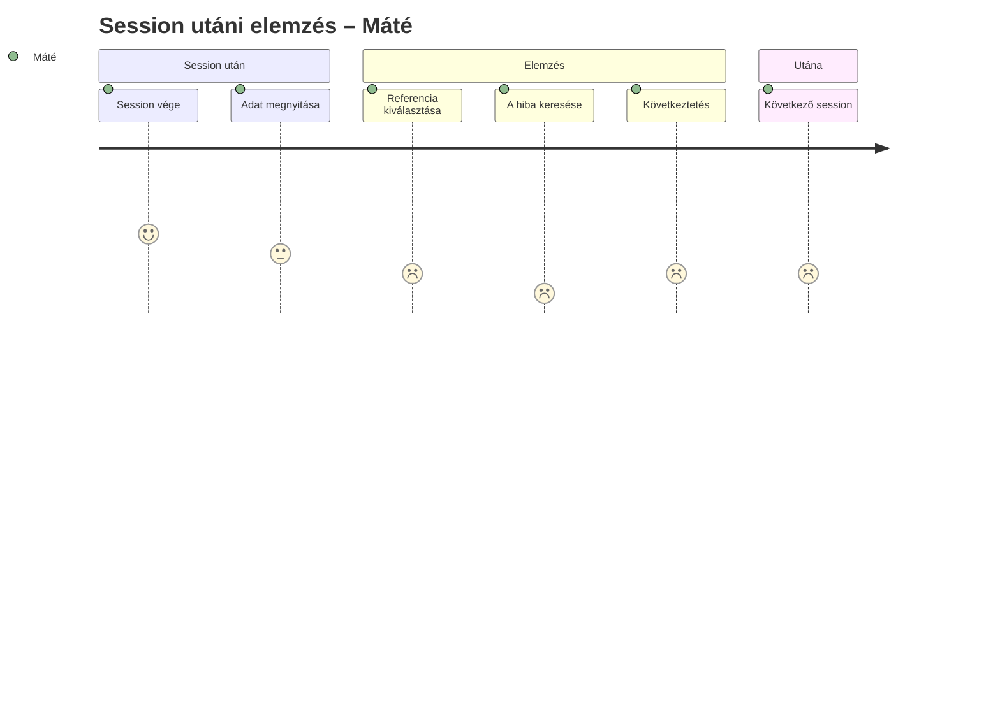

# Kutatás elemzése – affinity map, insightok, persona, user journey

> A forrásadatok a [02-interjuk.md](02-interjuk.md) fájlban vannak (szintetikus, AI-generált interjúk). Minden állítás mellett szerepel a bizonyíték azonosítója (pl. `R1-3`). A vizuális változat a FigJam-board **„2. Kutatás”** szekciójában található.

## 1. Affinity map

A cetliket előre kitalált kategóriák nélkül csoportosítottam. Minden csoport neve egy állítás, és mindegyiknél szerepel, hány **különböző résztvevő** adatából áll.

| # | Csoport (állítás) | Résztvevők | Cetlik |
|---|---|---|---|
| A | **A nyers adatból nem derül ki, melyik kanyarban kell keresni: a csatornák és a görbék elviszik a figyelmet.** | 3 (R1, R2, R5) | R1-2, R1-3, R1-4, R1-7, R2-1, R2-3, R5-3, R5-4, R5-7 |
| B | **Ha az adatból nem jön válasz, a versenyző emberhez vagy videóhoz fordul, mert konkrét teendőt keres.** | 3 (R1, R2, R5) | R1-6, R2-2, R2-5, R2-6, R5-5 |
| C | **A leggyorsabb kör nem hasznos referencia, és azt, hogy egy kör összehasonlítható-e, egyik eszköz sem segít eldönteni.** | 3 (R1, R3, R4) | R1-5, R3-4, R4-3, R4-4, R4-6 |
| D | **Azért fizetnek, ami embert, csapatot vagy konkrét javulást ad, nem a grafikonokért.** | 3 (R3, R4, R5) | R3-5, R4-5, R5-6 |
| E | **Az elemzés ideje és eszköze változó: van, aki azonnal elemez, van, aki másnap, másik gépen.** | 3 (R1, R3, R4) | R1-1, R3-3, R4-1, R4-2 |
| F | **Elfelejtett felvétel miatt hiányzik pont az a kör, amelyiket meg akarnák nézni.** | 2 (R2, R5) | R2-4, R5-1, R5-2 |
| G | *Ellenpélda:* **a haladó, setupot hangoló versenyző hosszú tanulás és külső segítség után már gond nélkül elemez.** | 1 (R3) | R3-1, R3-2, R3-6 |

**Az ellenpélda (G) tanulsága:** R3-nak nem azért könnyű az elemzés, mert az eszköz egyszerű, hanem mert egy hónapig tanulta, és egy barátja segített összeállítani a munkafelületét. Ez inkább megerősíti, hogy a belépési küszöb magas, a középhaladók számára pedig éppen ez a tanulási idő hiányzik.

## 2. Insightok (a két legerősebb csoportra)

Sablon: **megfigyelés → értelmezés → tervezési következmény.** Az A és a B csoportot azért választottam, mert ezeknek a legsúlyosabb a következménye: a felhasználó teljesen feladja az elemzést. Ráadásul közvetlenül a legkockázatosabb feltételezést érintik.

### Insight 1 – „Kanyarban gondolkodnak, az eszköz csatornákban beszél” (A csoport)
- **Megfigyelés:** 5 résztvevőből 3 (R1, R2, R5) nem találja meg a nyers adatban a problémás kanyart. R1 négy percig váltogat a görbék között, és a térképen keresi, melyik kanyarnál jár (R1-3, R1-4). R2 a 40 csatorna láttán bezárja a MoTeC-et (R2-1). R5 csak a szektoridőt nézi, de egy szektorban négy kanyar van (R5-4). Egyiküknél sem az érdeklődés hiányzik: R2 pontosan tudja, hogy a hármas kanyarban lassú (R2-3).
- **Értelmezés:** a versenyző kérdése kanyarszintű („melyik kanyarban, és mit csinálok rosszul?”), a mai eszközök viszont csatornaszintűek. A kettő közötti fordítást a felhasználóra hagyják, és a középhaladók itt elakadnak.
- **Tervezési következmény:** a session utáni első nézet egy **névvel ellátott, időveszteség szerint rangsorolt kanyarlista** legyen. A részletes görbék csak egy kiválasztott kanyarra, 2–3 releváns csatornával jelenjenek meg (fék, gáz, sebesség). Ez egyben a kognitív túlterhelés korlátjára is válasz.

### Insight 2 – „Nem adatot keresnek, hanem kipróbálható teendőt” (B csoport)
- **Megfigyelés:** 3 résztvevő (R1, R2, R5), amikor az adatból nem kap választ, YouTube-onboardhoz vagy Discordhoz fordul (R1-6, R2-2, R5-5). R2 megfogalmazása szerint egy konkrét utasítást, például 10 méterrel későbbi fékezést azonnal kipróbálna (R2-5).
- **Értelmezés:** az adat a felhasználónak csak eszköz. A tényleges cél egy olyan teendő, amelyet a következő sessionben ki lehet próbálni. Amíg az eszköz ezt nem adja meg, a felhasználó emberhez fordul, ami lassú (R5 egy napot várt) és esetleges.
- **Tervezési következmény:** minden kiemelt kanyarhoz tartozzon **egy rövid, kipróbálható javaslat** (például: „a referencia ~12 m-rel később fékez, kisebb nyomással”), és a következő session után látszódjon, sikerült-e. A javaslat mélysége lehet a freemium és a prémium közötti határ; ezt a 4. fejezetben kell eldönteni.

### További jelölt (C csoport, nem kidolgozott insight)
A referenciakör kiválasztása önálló döntés, amelyet ma egyik eszköz sem támogat (R1-5, R4-4). Lehetséges következmény: **ajánlott referenciakör** indoklással (azonos autó, hasonló setup, ~0,5–1 mp-cel gyorsabb kör).

## 3. Persona – feladatközpontú célfelhasználó-leírás

**Máté, a fejlődni akaró hétközi versenyző** (kitalált név, az R1, R2, R4 és R5 mintázataiból sűrítve)

| Elem | Leírás | Forrás |
|---|---|---|
| **Helyzet** | Hétköznap este, egy edzés vagy verseny után, fáradtan. Azonnal vagy másnap néz rá az adatokra, többnyire a szimulátoros gépen. | R1-1, R4-1, R4-2 |
| **Cél** | Megtalálni azt az 1–2 kanyart, ahol a legtöbb időt veszíti, és egy konkrét, kipróbálható teendővel ülni vissza. | R2-3, R2-5, R1-2 |
| **Tudás és eszköz** | Ismeri a fogalmakat (féktáv, apex, trail braking), de az adatolvasás nem rutin neki. Garage 61 ingyenes változatát használja, MoTeC-et legfeljebb egyszer próbált. | R1-2, R2-1, R5-3 |
| **Korlát** | Kevés idő és figyelem verseny után. Túl sok csatorna, a kanyarnevek nem látszanak. Nem tudja, kinek a körével érdemes összehasonlítani. Néha elfelejti bekapcsolni a felvételt. | R1-3, R1-4, R4-4, R5-1 |
| **Kockázat** | Rossz helyen keres javulást, vagy feladja, ezért hetekig nem fejlődik. Rossz referencia alapján olyan féktávot próbál lemásolni, ami nem neki való. | R1-6, R4-3 |

**Feltevések (kutatással nem igazolt, külön jelölve):**
- Hetente 2–4 versenyt fut. (Az interjúk ezt csak részben támasztják alá.)
- Hajlandó havi előfizetésre, ha konkrét gyorsulást lát.
- Az angol nyelvű kanyar- és csatornaneveket érti.

## 4. User journey – egyetlen feladat

**Feladat:** egy edzés után megtalálni, hol veszít időt, és javítási tervvel visszaülni a következő sessionre.

| Szempont | 1. Session vége | 2. Adat megnyitása | 3. Referencia kiválasztása | 4. A hiba keresése | 5. Következtetés | 6. Következő session |
|---|---|---|---|---|---|---|
| **Lépések** | Kiszáll, megnézi a köridőt és a pozíciót. | Megnyitja a Garage 61-et vagy a MoTeC-et, ha volt felvétel. | A ranglista leggyorsabb körét választja. | Görget a delta-, fék- és gázgörbék között, és keresi a kanyart. | Megpróbál szabályt levonni, vagy feladja, és videót néz. | Ugyanúgy vezet, vagy egy videó alapján próbálkozik. |
| **Gondolatok** | „1,2 mp-et kaptam, de hol?” (R1-2) | „Pont arról a körről nincs adatom.” (R5-2) | „Ez egy alien, ő teljesen máshol fékez.” (R1-5) | „Ez most a Pouhon vagy a Fagnes?” (R1-4) | „Tíz perc után bezárom.” (R1-6) | „Tudom, hogy a hármasban lassú vagyok, csak azt nem, miért.” (R2-3) |
| **Érzés** | Motivált | Bizonytalan | Gyanakvó | Elveszett | Feladja | Csalódott |
| **Fájdalompont** | Csak az összesített időveszteséget látja. | Elfelejtett felvétel, hiányzó adat. | Nem összehasonlítható referencia. | **Sok csatorna, nincs kiemelés, a kanyarnevek nem látszanak.** | Nincs kipróbálható teendő. | Nem látja, javult-e. |
| **Lehetőség** | Azonnali összefoglaló a session után. | Automatikus mappafigyelés, figyelmeztetés hiányzó felvételnél. | Ajánlott referenciakör indoklással. | Rangsorolt kanyarlista névvel, 2–3 csatornával. | Kanyaronként egy kipróbálható javaslat. | Visszamérés: sikerült-e a javaslat. |

### Érzésgörbe (1 = legrosszabb, 5 = legjobb)

**A legnagyobb fájdalompont a 4. lépés (a hiba keresése)**, ide tartozik az **Insight 1**. A görbe itt a mélyponton van, ezért itt érdemes először beavatkozni.

## 5. Az 1. házi feltételezéseinek frissítése

| Feltételezés (1. házi) | Eredmény | Mi változik? |
|---|---|---|
| **Legkockázatosabb:** nem az érdeklődés hiányzik, hanem az eszközök túl bonyolultak. | **A szintetikus minta támogatja** (R1, R2, R4, R5). Az érdektelenségre nincs jel. | Az alapötlet marad, de valódi felhasználókkal is ellenőrizni kell. |
| Közvetlenül a session után, ugyanazon a gépen elemeznek. | **Részben cáfolva** (R4 másnap, laptopon; R3 tervezetten, verseny előtt). | Kell egy session-előzmény, hogy később is vissza lehessen nézni. A natív desktop app marad (brief), de a mobilos vagy webes visszanézés nyitott kérdés. |
| Kanyarokra bontva a legérthetőbb az időveszteség (szakmai szabály). | **Megerősítve:** a szektoridő túl durva felbontás (R5-4). | Kanyarszintű bontás, kanyarnevekkel. |
| Hajlandók havi előfizetést fizetni. | **Nyitott.** Azért fizetnek, ami embert vagy konkrét javulást ad (R3-5, R4-5, R5-6). | A prémium értéke valószínűleg a javaslatokban van, nem a grafikonokban (feltevés). |

## 6. Nyitott kérdések a következő fejezetekhez
- Hogyan nevezzük el automatikusan a kanyarokat az iRacing pályáinál? (Technikai korlát, brief-egyeztetés.)
- Mennyire bíznak meg a felhasználók egy gépi javaslatban, összehasonlítva egy coach-csal? (Értékelő kutatás a prototípussal, 8. fejezet.)
- Hol legyen a freemium és a prémium határa: a kanyarlistánál vagy a javaslatoknál? (4. fejezet.)
